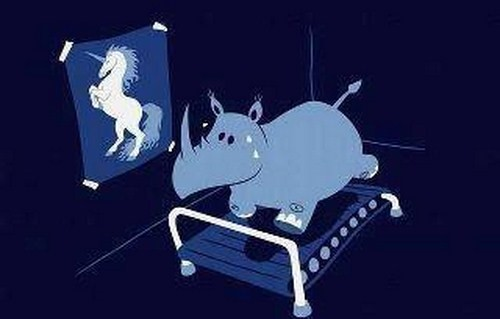

# Visual Narrative Arbitration: Benchmarking Frontier VLMs via Multi-Modal Caricature Comprehension

This repository contains the experimental framework, prompt registries, and psychometric evaluation matrices for benchmarking frontier Vision-Language Models (VLMs) against human behavioral baselines. 

The core objective of this research is to isolate the exact breakdown point between bottom-up sensory perception and top-down cognitive reasoning when AI interprets complex, socio-cultural visual abstractions (cartoons and political caricatures).

---

## 🧠 Core Theoretical Framework

Current multimodal evaluation protocols heavily rely on constrained, multiple-choice options that artificially inflate model accuracy and mask deep architectural alignment gaps. This framework introduces an **unconstrained three-tier protocol** designed to track model capabilities across a four-stage visual narrative comprehension chain:

1. **Component Perception** (Low-level asset extraction)
2. **Symbol Detection** (Semantic identification)
3. **Component Relational Extraction** (Structural connection)
4. **Inter-Relational Reasoning** (Holistic abstraction & Theory of Mind)

---

## 🛠️ The Three-Tier Diagnostic Testing Suite

To determine whether VLM failures stem from raw visual deficits or higher-order logic breakdowns, the architecture deploys three decoupled evaluation layers across 3 independent session replications:

### 1. Whole Image Comprehension Test (Holistic Baseline)
* **Objective:** Establishes the baseline unconstrained open-response performance of the VLM when facing a complete, unedited caricature using a two-part Chain-of-Thought prompt (*Objective Description* followed by *Semantic Interpretation*).

### 2. Cut-Image Isolation Test
* **Objective:** Feeds the model fragmented, out-of-context visual crops of specific components stripped of narrative context.
* **Diagnostic Rule:** If a model misidentifies or distorts an object in the holistic test but describes it flawlessly in isolation, the error is flagged as a top-down cognitive fabrication (**E4b**) rather than a genuine sensory limitation (**E1/E2**).

### 3. Text-Based Control Test
* **Objective:** Replaces the image entirely with a fact-checked, edited textual description of the physical layout and explicit spatial relationships (resolving Stages 1–3).
* **Diagnostic Rule:** Bypasses the multimodal vision engine to test pure Stage 4 abstract logic. A significant score spike in the text condition indicates a multimodal vision-language bottleneck; stagnant or degraded scores indicate a fundamental deficit in abstract relational reasoning or Theory of Mind (**E3**).

---

## 📊 Structural Error Taxonomy (E0–E4)


All examples below reference a single standardized anchor stimulus: *a rhinoceros running hard on a treadmill in a dark room, sweat visible on its face, gazing at a poster of a rearing unicorn on the wall.*

| Code | Name | Operational Definition | Anchor Example (Rhino / Unicorn Caricature) |
| :--- | :--- | :--- | :--- |
| **E0** | **Non-engagement** | The model declines to offer a symbolic or figurative interpretation, treating the image as having no meaning beyond its literal content. | *"This is just a picture of a rhino exercising. There is no deeper meaning."* |
| **E1** | **Omission** | A visual element actually present in the image is completely undetected or omitted from the description. | The unicorn poster on the wall is never mentioned, even though the rhino’s entire posture and gaze are directed toward it. |
| **E2** | **Misidentification** | A visual element is detected, but assigned an incorrect identity, category, or label. | The animal on the poster is described as *"a horse"* rather than *"a unicorn,"* missing the single horn that signals an impossible ideal. |
| **E3** | **Relational Error** | Two or more individually correct elements are connected incorrectly, or a meaningful relationship between them is never established. | Both the rhino and the poster are identified, but the response describes the exercise and the poster as unrelated details rather than recognizing the rhino striving toward an unattainable ideal. |
| **E4** | **Confabulation / Hallucination** | **E4a (Hallucination):** Reporting an element with no visual basis.<br>**E4b (Motivated Confabulation):** Altering the perception of a real element to fit a premature narrative. | **E4a:** Inventing a trainer standing beside the treadmill.<br>**E4b:** Describing the sweat on the rhino’s face as *"tears of despair"* to fit a fabricated narrative of sadness rather than physical exertion. |

---

## 📂 Repository Structure

```text
.
├── README.md                           # Project brief, diagnostic suite, and E0–E4 taxonomy
├── LICENSE                             # MIT Academic Open Source License
├── data/
│   ├── raw_stimuli/
│   │   ├── whole_images/               # Unedited test caricatures
│   │   └── isolation_crops/            # Cropped segments for sensory intactness checks
│   ├── text_controls/
│   │   └── annotated_descriptions.json # Fact-checked, edited text strings (Stages 1–3 resolved)
│   └── human_baselines/
│       └── anonymized_baselines.csv    # Human baseline tracking data and 0–2 VLM scores
├── models/
│   ├── prompt_templates/               # Holistic, isolation, and text-control prompts
│   └── chat_transcripts/               # Archived multi-session open-ended model logs
└── analysis/
    ├── error_classifiers/              # Qualitative & programmatic E0–E4 classification logs
    └── statistical_spss/               # SPSS syntax scripts (.sps) and matrices (.sav)
```

---

## 📝 Intellectual Safety & Research Disclosure
This repository contains structural metrics evaluating human psychological baseline comparisons. All stimulus registries, psychometric data management protocols, and behavioral tracking pipelines are designed exclusively for computational evaluation, model capability limits assessment, and benchmarking of artificial vision systems. This research does not involve clinical diagnostic trials or direct human health interventions.
